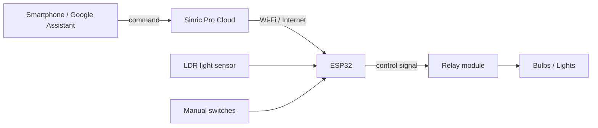
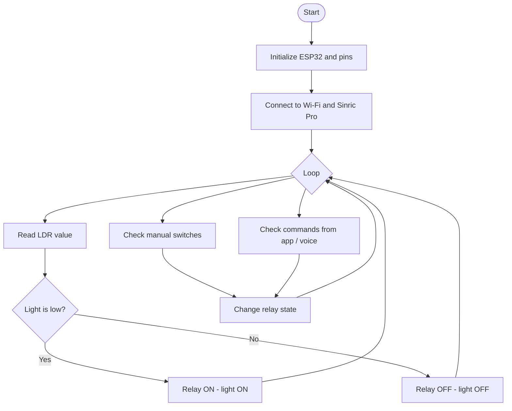

# ESP32 Powered Intelligent Smart Home System

An IoT-based smart lighting system built with an **ESP32**, an **LDR (light sensor)** and a **relay module**.
The light turns **ON automatically when the room is dark** and **OFF when there is enough light**.
It can also be controlled from a **smartphone over Wi-Fi** (Sinric Pro) and with **Google Assistant voice commands**.
Physical switches are also provided, so the lights still work without internet.

> **Project type:** Hardware + IoT  |  **Controller:** ESP32  |  **Cloud:** Sinric Pro  |  **Language:** C++ (Arduino)

---

## Features

- **Automatic mode:** an LDR measures the room light and the ESP32 switches the bulb ON or OFF.
- **Manual mode:** physical switches control the lights, and this works even without internet.
- **Remote mode:** control the lights from a mobile app through Wi-Fi using Sinric Pro.
- **Voice control:** works with Google Assistant (for example "turn on the light").
- **Safe switching:** a relay module lets the low-voltage ESP32 control high-voltage lights.
- **Expandable:** the system can control multiple lights and more appliances.

## How it works



Program flow:



## Hardware required

| Component | Purpose |
|-----------|---------|
| ESP32 development board | Main controller with built-in Wi-Fi |
| LDR (module, or LDR with a fixed resistor) | Measures the surrounding light |
| Relay module (1 or more channels) | Switches the lights ON/OFF safely |
| Bulbs and bulb holders | The load that is controlled |
| Push buttons / switches | Manual control |
| Jumper wires and breadboard | Connections |
| 5V power supply (USB) | Powers the ESP32 and relay module |

## Wiring

Fill in the pins that you used in your build.

| Signal | ESP32 pin | Notes |
|--------|-----------|-------|
| LDR output | GPIO __ | Use an ADC1 pin (GPIO 32-39). ADC2 pins do not work while Wi-Fi is on |
| Relay IN (light 1) | GPIO __ | Many relay modules are active LOW |
| Relay IN (light 2) | GPIO __ | Optional |
| Relay IN (light 3) | GPIO __ | Optional |
| Switch 1 | GPIO __ | Use `INPUT_PULLUP`, connect the other side to GND |
| VCC / GND | 5V or 3V3 / GND | Check what your relay module needs |

## Software requirements

- Arduino IDE 2.x
- **ESP32 board package** by Espressif (Boards Manager)
- **SinricPro** library (with its dependencies **ArduinoJson** and **WebSockets**)

## Setup

1. **Clone** this repository.
2. Go to the `firmware/` folder and copy `secrets.h.example` to `secrets.h`.
3. Open `secrets.h` and enter your Wi-Fi name, Wi-Fi password and Sinric Pro keys.
   **Never upload `secrets.h` to GitHub** (it is already listed in `.gitignore`).
4. Put your sketch (`.ino`) in the `firmware/` folder (see `firmware/README.md`).
5. In Arduino IDE choose **ESP32 Dev Module** and the correct COM port, then **Upload**.
6. Create a free account on Sinric Pro, add a **Switch** device for each light and copy the **App Key**, **App Secret** and **Device ID** into `secrets.h`.
7. In the **Google Home** app, link the **Sinric Pro** service to see your devices and control them by voice.

## Safety

The lights work on **mains voltage (230V AC)**, which can be dangerous.

- Switch off the mains supply before touching any wiring.
- Use properly insulated wires and keep the relay and mains side inside an enclosure.
- Test the logic with a low-voltage load (like an LED) before connecting a real bulb.
- Do not work on mains wiring if you are not trained to do it.

## Repository structure

```
.
├── README.md          # project overview and setup
├── plan.md            # project plan and design
├── report.md          # full project report
├── .gitignore
├── firmware/          # ESP32 code
│   ├── README.md
│   └── secrets.h.example
└── docs/
    └── images/        # photos and diagrams
```

## Future improvements

- Add more rooms and appliances (fan, TV, etc.).
- Add a mobile dashboard with energy-use readings.
- Add a PIR motion sensor for presence-based control.
- Add an OLED display showing status.

## License

Add a license file (for example MIT) before sharing publicly.
