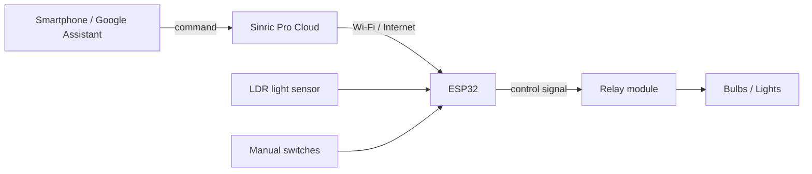
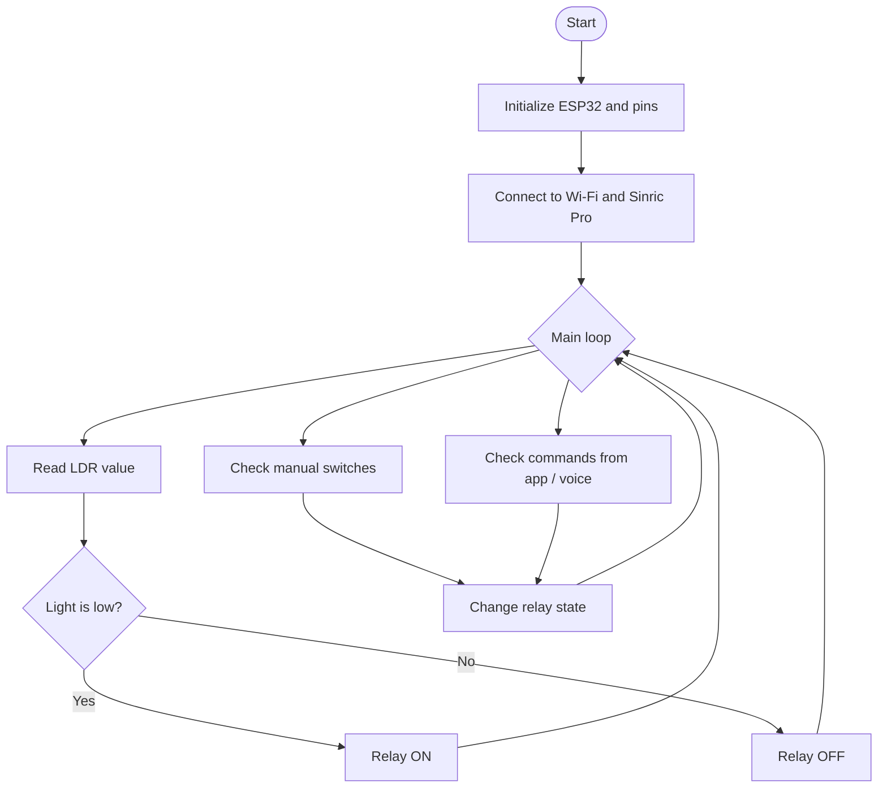

# Project Plan: ESP32 Powered Intelligent Smart Home System

**Version:** 1.0  |  **Type:** Hardware + IoT project

This document explains what the project does, how it is designed, how it is built step by step, and how it is tested.

---

## 1. Goal

Build a simple, low-cost and reliable smart lighting system that:

- turns a light **ON when the room is dark** and **OFF when there is enough light**,
- can be **controlled from a smartphone** through Wi-Fi,
- can be **controlled by voice** with Google Assistant,
- still works **manually with switches** when there is no internet.

## 2. Objectives

1. Use an ESP32 as the central controller.
2. Use an LDR to detect the amount of light in the room.
3. Switch the lights safely using a relay module.
4. Connect the ESP32 to the cloud using Sinric Pro for app and voice control.
5. Reduce unnecessary power use and human effort.

## 3. Scope

### Included in version 1
| # | Feature | Done when |
|---|---------|-----------|
| 1 | Read light level with the LDR | Value is printed in the Serial Monitor |
| 2 | Automatic ON/OFF using a light threshold | Bulb turns ON in the dark and OFF in light |
| 3 | Relay control of the bulb | Relay clicks and the bulb switches |
| 4 | Manual switch control | Bulb toggles with the switch, even with Wi-Fi off |
| 5 | Wi-Fi connection | ESP32 gets an IP address |
| 6 | Sinric Pro control from the app | Bulb switches from the mobile app |
| 7 | Google Assistant voice control | "Turn on the light" works |
| 8 | Support for more than one light | Each light has its own relay channel |

### Not included in version 1 (future work)
Energy-use monitoring, motion sensor, scheduling, OLED display, own mobile app.

## 4. System architecture



**Idea:** the ESP32 is the brain. It reads the sensor and the switches, listens for cloud commands, and decides the state of the relay. The relay is the safe switch for the high-voltage bulb.

## 5. Components

| Component | Quantity | Purpose |
|-----------|----------|---------|
| ESP32 development board | 1 | Main controller with Wi-Fi |
| LDR (module, or LDR + fixed resistor) | 1 | Light sensing |
| Relay module (1 / 2 / 4 channel) | 1 | Switching the lights |
| Bulb + holder | 1 or more | Load |
| Push button / switch | 1 or more | Manual control |
| Jumper wires, breadboard | as needed | Connections |
| 5V USB power supply | 1 | Power |

## 6. Control modes and logic

| Mode | Input | Works without internet? |
|------|-------|-------------------------|
| Automatic | LDR reading compared with a threshold | Yes |
| Manual | Physical switch | Yes |
| Remote | Mobile app through Sinric Pro | No (needs internet) |
| Voice | Google Assistant through Sinric Pro | No (needs internet) |

Automatic rule:

```
if light level is LOW   -> relay ON  (light ON)
if light level is HIGH  -> relay OFF (light OFF)
```

Design tips for this rule:

- Keep a **small gap between the ON and OFF thresholds** (hysteresis) so the light does not flicker when the room light is near the limit.
- **Average a few readings** of the LDR to ignore sudden changes (like a shadow passing).
- Decide the **priority** between automatic mode and a manual or app command, and write it in the code comments so the behaviour is clear.



## 7. Pin plan

Fill this table with the pins that you used.

| Signal | ESP32 pin | Notes |
|--------|-----------|-------|
| LDR output | GPIO __ | ADC1 pin (GPIO 32-39). ADC2 pins do not work with Wi-Fi on |
| Relay 1 IN | GPIO __ | Check if the module is active LOW |
| Relay 2 IN | GPIO __ | Optional |
| Relay 3 IN | GPIO __ | Optional |
| Switch 1 | GPIO __ | `INPUT_PULLUP`, other side to GND |

## 8. Software plan

- **IDE:** Arduino IDE with the ESP32 board package.
- **Libraries:** SinricPro (with ArduinoJson and WebSockets).
- **Secrets:** keep Wi-Fi name, password and Sinric Pro keys in `firmware/smart_home/secrets.h` (not uploaded to GitHub).
- **Cloud:** one **Switch** device per light in Sinric Pro, linked to the Google Home app.

## 9. Build order

| Step | Task | Test before moving on |
|------|------|-----------------------|
| 1 | Connect the LDR and print readings | Values go up in light, down in dark |
| 2 | Choose the threshold | Bulb logic switches at the right light level |
| 3 | Connect the relay with a low-voltage load (LED) | Relay clicks and the LED switches |
| 4 | Add manual switches | Switch toggles the load |
| 5 | Add Wi-Fi | IP address printed |
| 6 | Add Sinric Pro | Device shows online, app switches the relay |
| 7 | Link Google Home | Voice command works |
| 8 | Connect the real bulb (with safe mains wiring) | Full demo works |

## 10. Test checklist

- [ ] LDR readings change correctly with light
- [ ] Bulb turns ON in the dark and OFF in light without flickering
- [ ] Manual switch works with Wi-Fi turned off
- [ ] App command switches the light
- [ ] Voice command switches the light
- [ ] ESP32 reconnects after a Wi-Fi or power failure
- [ ] Each light works independently (if more than one)

## 11. Risks and fixes

| Problem | Likely cause | Fix |
|---------|--------------|-----|
| LDR value not changing or always the same | Used an ADC2 pin with Wi-Fi on, or wrong divider | Use an ADC1 pin and check the resistor divider |
| Light flickers near the threshold | No gap between ON and OFF levels | Add hysteresis and average the readings |
| Relay works opposite (ON when it should be OFF) | Active LOW relay module | Invert the output logic in code |
| ESP32 resets when the relay switches | Weak power supply or noise | Use a stable 5V supply and a common GND |
| Device shows offline in Sinric Pro | Wrong keys or no internet | Check keys in `secrets.h` and the Wi-Fi |
| Voice command not understood | Device name not clear | Use a simple device name like "Light" |

## 12. Safety

- Mains voltage is dangerous. Switch OFF the supply before touching wiring.
- Keep the relay and all mains wires inside an insulated enclosure.
- Test everything with a low-voltage load first.

## 13. Definition of done

1. Automatic, manual, app and voice control all work.
2. The system recovers after a power or Wi-Fi failure.
3. Code, wiring table, photos and report are in the repository.
4. No Wi-Fi password or key is uploaded to GitHub.

## 14. Roadmap

| Version | Planned additions |
|---------|-------------------|
| **v1.0** | Features listed in section 3 |
| v1.1 | More rooms/appliances, scheduling |
| v1.2 | PIR motion sensor, energy monitoring |
| v2.0 | Own mobile dashboard, OLED display |

## 15. Change log

| Version | Notes |
|---------|-------|
| v1.0 | First plan created |
