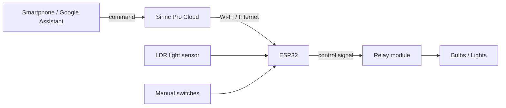
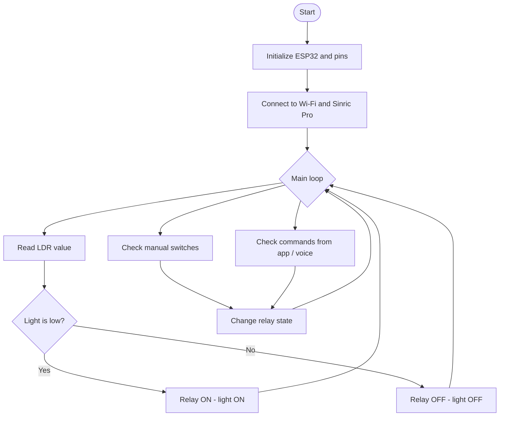

# ESP32 Powered Intelligent Smart Home System

**Project Report**

An IoT-based smart lighting system using ESP32, an LDR sensor, a relay module, Sinric Pro and Google Assistant.

---

## Abstract

This project presents an IoT-based smart home system built with the ESP32 microcontroller. An LDR (Light Dependent Resistor) measures the light in the room, and the system turns the bulb ON automatically when the light is low and OFF when the light is enough. The lights can also be controlled by physical switches and from a smartphone through Wi-Fi using Sinric Pro. With Sinric Pro, voice commands through Google Assistant can also be used. A relay module is used so that the low-voltage ESP32 can switch the high-voltage lights safely. The system is simple, low-cost and reliable, saves energy, and reduces human effort.

---

## Chapter 1: Introduction

In today's world, technology is advancing rapidly and plays a major role in making daily life easier, faster and more efficient. One of the most important developments in this field is the Internet of Things (IoT). IoT is a system in which physical devices are connected to the internet and can communicate with each other. This technology allows users to control and monitor devices remotely, which increases convenience, reduces human effort and helps in better energy management.

Home automation is one of the most popular applications of IoT. In a traditional system, electrical appliances such as lights are operated manually using switches, which can be inconvenient, especially when the user is not at home. With the help of IoT, these appliances can be controlled from anywhere using a smartphone or voice commands. This provides comfort and also improves safety and efficiency in daily life.

This project focuses on the design and implementation of an IoT-based smart light control system using the ESP32. The ESP32 is a powerful and low-cost microcontroller with built-in Wi-Fi, which makes it highly suitable for IoT applications. It works as the central unit of the system, receives input signals and controls the connected devices. The system can control multiple lights and can be expanded further as per the user's needs.

The proposed system works in two ways: manual control and remote control. In manual mode, physical switches are used to turn the lights ON and OFF, so the system keeps working even without internet. In remote mode, the ESP32 connects to a Wi-Fi network and talks to a cloud platform, allowing users to control the lights from a mobile device or a voice assistant. For this, the system uses **Sinric Pro**, which works as a bridge between the hardware and the user. It allows integration with voice assistants like Google Assistant, so the lights can be controlled with simple voice commands.

When the user gives a command through the mobile app or voice assistant, the command is sent to the cloud server and then forwarded to the ESP32 through the internet. The ESP32 processes the command and controls the relay module connected to it. The relay works as a switch that turns the lights ON or OFF. This allows low-voltage control of high-voltage electrical devices in a safe way.

The main objective of this project is to create a simple, cost-effective and reliable smart lighting system that improves user convenience and promotes energy saving. By reducing unnecessary power use and enabling remote access, the system supports smarter and more sustainable living. The project can also be extended to control other home appliances, so it can become the base of a complete smart home system.

---

## Chapter 2: Literature Review

Home automation has changed a lot over the years. In the beginning, lights and appliances were controlled only with wall switches. Later, remote controls using infrared (IR) signals were introduced, but they need the remote to point towards the device and work only at a short distance. Some systems used Bluetooth, which is easy to set up but has a limited range. GSM-based systems use SMS messages for control, but they have a message cost and are slow.

With the growth of IoT, Wi-Fi based systems became popular because they allow control from anywhere through the internet. Microcontrollers like the ESP8266 and ESP32 made this easy and cheap because they have built-in Wi-Fi. The ESP32 is a newer and stronger board, with a faster processor and more pins than the ESP8266.

Cloud platforms such as Sinric Pro connect these boards to voice assistants like Google Assistant and Amazon Alexa. This removes the need to build a separate server or mobile app. Many earlier projects only used app or voice control, which stops working when the internet is down. Many also did not use sensors, so the user had to switch the lights by hand every time.

This project combines three methods in one system: automatic control using an LDR sensor, manual control using switches, and remote control using the app and voice. Because of this, the system keeps working even when the internet is not available, and it also saves energy by switching the light according to the room light.

---

## Chapter 3: Components and Tools Used

### Hardware components

- **ESP32 development board:** Main controller. It reads the sensor and switches, connects to Wi-Fi and controls the relay.
- **LDR (Light Dependent Resistor):** Measures the amount of light in the room. Its resistance changes with the light.
- **Relay module:** Works as an electrical switch. It lets the low-voltage ESP32 control the high-voltage bulb safely.
- **Bulb and holder:** The light that is controlled.
- **Push buttons / switches:** Used for manual control.
- **Jumper wires and breadboard:** Used for making the connections.
- **Power supply (5V USB):** Gives power to the ESP32 and the relay module.

### Software components

- **Arduino IDE:** Used to write the program and upload it to the ESP32.
- **ESP32 board package:** Adds ESP32 support to Arduino IDE.
- **SinricPro library:** Connects the ESP32 to the Sinric Pro cloud.
- **Sinric Pro platform:** Cloud service that links the device with the mobile app and Google Assistant.
- **Google Home app and Google Assistant:** Used for app and voice control.

---

## Chapter 4: System Design and Architecture

The system is built around the ESP32. The LDR and the manual switches are the inputs. The relay module is the output, and it controls the bulb. The ESP32 also connects to the cloud through Wi-Fi for app and voice commands.

Main parts of the design:

- **Sensing:** The LDR gives an analog value that shows how bright the room is.
- **Processing:** The ESP32 compares the light value with a set limit and checks the switches and cloud commands.
- **Switching:** The relay module turns the bulb ON or OFF.
- **Communication:** The ESP32 connects to Sinric Pro through Wi-Fi and receives commands from the mobile app or Google Assistant.

The relay keeps the low-voltage side (ESP32) separate from the high-voltage side (bulb), which makes the system safer. More relay channels can be added to control more lights.

---

## Chapter 5: Methodology and Working Principle

### Methodology

1. The required components, such as the ESP32, LDR, relay module, bulbs and switches, were selected.
2. The circuit was designed and the components were connected using jumper wires.
3. The program was written in Arduino IDE. It reads the LDR value, checks the switches and controls the relay.
4. The Wi-Fi connection was added, and the ESP32 was linked with Sinric Pro using the keys from the Sinric Pro account.
5. The device was linked with the Google Home app so that Google Assistant could control the lights.
6. The complete system was tested in different light conditions and in both online and offline situations.

### Working principle

- **Automatic mode:** The LDR measures the light in the room. When the light is low, the ESP32 turns the relay ON and the bulb glows. When the light is enough, the ESP32 turns the relay OFF.
- **Manual mode:** When a switch is pressed, the ESP32 changes the state of the relay. This works without internet.
- **Remote and voice mode:** The user gives a command from the mobile app or says it to Google Assistant. The command goes to the Sinric Pro cloud and then to the ESP32 through Wi-Fi. The ESP32 changes the relay state according to the command.

---

## Chapter 6: Implementation and Experimental Setup

In this project, all the hardware parts were connected on a breadboard using jumper wires. The LDR was connected to an analog input pin of the ESP32. The relay module was connected to digital output pins, and the manual switches were connected to input pins. The bulbs were connected through the relay module. The ESP32 was programmed with Arduino IDE, and the Wi-Fi name, password and Sinric Pro keys were kept in a separate file so that they are not shared publicly.

For testing, the Sinric Pro device was created and linked with the Google Home app. The system was then checked by changing the light in the room, using the manual switches, using the mobile app and giving voice commands.

<!-- Add your hardware photo here, for example:

-->

*Figure 1: Hardware implementation of the smart home system (add your photo in `docs/images/`).*

---

## Chapter 7: Results and Observations

The system was tested in different conditions, and it worked as expected.

- The ESP32 connected properly to the Wi-Fi network and worked with Sinric Pro.
- In low light, the bulb turned ON automatically, and in enough light, it turned OFF.
- The lights were controlled from the mobile app through Wi-Fi.
- Voice commands through Google Assistant controlled the lights.
- The relay module responded correctly to all operations.
- The manual switches worked properly, even without an internet connection.
- The overall performance of the system was stable.

---

## Chapter 8: Applications and Future Scope

### Applications

- Smart lighting in homes, which saves energy and effort.
- Street lights and corridor lights that switch ON at night and OFF in the day.
- Offices, classrooms and shops for automatic lighting.
- Helping elderly and disabled people, who can control lights by voice.
- A base for a complete smart home system with other appliances.

### Future scope

- Add other appliances such as fans, TV and air conditioners.
- Add a PIR motion sensor so that lights work only when someone is in the room.
- Add energy monitoring to show the power used.
- Add timers and schedules.
- Make an own mobile app or web dashboard.

---

## Chapter 9: Challenges and Learning

Projects like this have some common challenges. Some of the main ones are:

- **Using the correct analog pin:** On the ESP32, some analog pins (ADC2) do not work while Wi-Fi is ON, so an ADC1 pin has to be used for the LDR.
- **Flickering near the limit:** If the room light is close to the set limit, the bulb can switch ON and OFF again and again. This is reduced by keeping a small gap between the ON and OFF levels and by averaging a few readings.
- **Relay type:** Many relay modules work with a LOW signal, so the logic may need to be reversed.
- **Stable power:** A weak power supply can reset the ESP32 when the relay switches.
- **Keeping keys safe:** Wi-Fi passwords and cloud keys should be kept out of the public code.
- **Mains safety:** Working with high voltage needs proper insulation and care.

Through this project, we gained practical knowledge of the ESP32, sensors, relay modules and cloud-based control. We learned how a device can be controlled from a phone and by voice, how hardware and software work together, and how important testing and safety are in electronics projects.

---

## Chapter 10: Conclusion

The ESP32 powered intelligent smart home system was designed and implemented successfully. The system turns the light ON or OFF automatically using an LDR sensor, and it can also be controlled by manual switches, a smartphone app and Google Assistant voice commands. Because of the manual switches and the automatic mode, it keeps working even without internet.

The system is simple, low-cost and reliable. It reduces human effort, improves convenience and helps in saving energy. It can be extended easily to more lights and other appliances, so it can become the base of a complete smart home automation system.

---

## References

- [Arduino-ESP32 Documentation (Espressif)](https://docs.espressif.com/projects/arduino-esp32/en/latest/)
- [ESP32 Overview (Espressif)](https://www.espressif.com/en/products/socs/esp32)
- [Sinric Pro](https://sinric.pro/)
- [Sinric Pro Help and Documentation](https://help.sinric.pro/)
- [SinricPro SDK for ESP8266 and ESP32 (GitHub)](https://github.com/sinricpro/esp8266-esp32-sdk)
- [Arduino IDE](https://www.arduino.cc/en/software)
